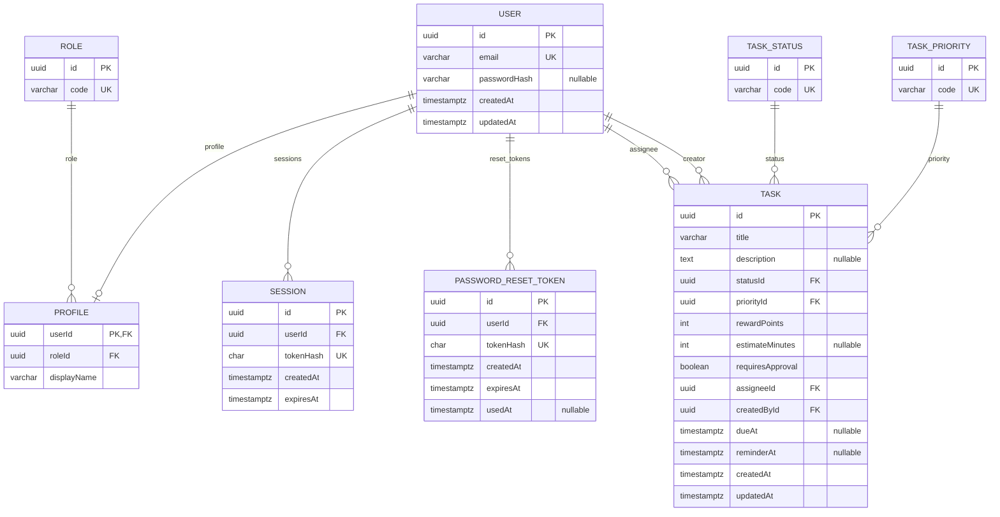

# Database Schema

This document describes the database foundation for FamilyTODO authentication,
task creation, and a single-family installation. The canonical Prisma model is
in [`../../apps/api/prisma/schema.prisma`](../../apps/api/prisma/schema.prisma).
The initial migration and the follow-up migration
[`../../apps/api/prisma/migrations/20261104120000_allow_unset_passwords/migration.sql`](../../apps/api/prisma/migrations/20261104120000_allow_unset_passwords/migration.sql)
have been applied to Neon. It normalizes existing emails and changes empty
password hashes to `NULL`. Accounts without a set password have a `NULL`
`passwordHash`. The Task Creation migration
[`../../apps/api/prisma/migrations/20261116091000_add_task_creation_schema/migration.sql`](../../apps/api/prisma/migrations/20261116091000_add_task_creation_schema/migration.sql)
has also been applied to Neon.

The API Prisma configuration loads `apps/api/.env.local` for local CLI commands.
Prisma schema and migration commands use `DATABASE_URL_UNPOOLED`, while the
pooled `DATABASE_URL` is reserved for application runtime connections.

```sh
pnpm --filter @familytodo/api db:generate
pnpm --filter @familytodo/api db:migrate:dev
```

`db:migrate:dev` applies schema changes to the configured development database.
Verify that `.env.local` points to the intended Neon development database
before running it. If the initial SQL was run manually in Neon rather than with
Prisma Migrate, verify Prisma migration history before using `migrate dev` or
`migrate deploy`; do not reset the database to resolve a drift warning. The
email normalization step requires all existing emails to remain unique after
trimming and lowercasing.

## Tables and Relationships

The diagram below uses one ER format for every table in the canonical Prisma
schema. It represents the schema in code and matches the migrations applied to
Neon.



## Table Fields

### Role

| Field | Database shape | Description |
|---|---|---|
| `id` | UUID primary key | Generated by Prisma |
| `code` | Required `VARCHAR(32)`, unique | Stable role code; seeded with `PARENT` and `CHILD` |

### User

| Field | Database shape | Description |
|---|---|---|
| `id` | UUID primary key | Generated by Prisma |
| `email` | Required `VARCHAR(254)`, unique | Stored trimmed and lowercased |
| `passwordHash` | Nullable `VARCHAR(255)` | Null until the user sets a password; never stores plaintext |
| `createdAt` | Required `TIMESTAMPTZ(3)`, default now | Creation timestamp |
| `updatedAt` | Required `TIMESTAMPTZ(3)` | Maintained by Prisma |

### Profile

| Field | Database shape | Description |
|---|---|---|
| `userId` | UUID primary key and foreign key to `User.id` | Allows at most one profile per user; cascades when user is deleted |
| `roleId` | Required UUID foreign key to `Role.id` | Role is restricted from deletion while referenced |
| `displayName` | Required `VARCHAR(80)` | UI name such as “Mom,” “Dad,” or a child’s name |

### Session

| Field | Database shape | Description |
|---|---|---|
| `id` | UUID primary key | Generated by Prisma |
| `userId` | Required UUID foreign key to `User.id` | Cascades when user is deleted |
| `tokenHash` | Required `CHAR(64)`, unique | Stores only the hash of the opaque session token |
| `createdAt` | Required `TIMESTAMPTZ(3)`, default now | Creation timestamp |
| `expiresAt` | Required `TIMESTAMPTZ(3)` | Must be later than `createdAt` |

### PasswordResetToken

| Field | Database shape | Description |
|---|---|---|
| `id` | UUID primary key | Generated by Prisma |
| `userId` | Required UUID foreign key to `User.id` | Cascades when user is deleted |
| `tokenHash` | Required `CHAR(64)`, unique | Stores only the hash of the emailed reset token |
| `createdAt` | Required `TIMESTAMPTZ(3)`, default now | Creation timestamp |
| `expiresAt` | Required `TIMESTAMPTZ(3)` | Must be later than `createdAt` |
| `usedAt` | Nullable `TIMESTAMPTZ(3)` | Null while unused; set when consumed |

### TaskStatus

| Field | Database shape | Description |
|---|---|---|
| `id` | UUID primary key | Seeded with stable IDs |
| `code` | Required `VARCHAR(32)`, unique | Seeded codes: `OPEN`, `IN_PROGRESS`, `PENDING_APPROVAL`, `DONE`, `REJECTED` |

### TaskPriority

| Field | Database shape | Description |
|---|---|---|
| `id` | UUID primary key | Seeded with stable IDs |
| `code` | Required `VARCHAR(32)`, unique | Seeded codes: `LOW`, `NORMAL`, `HIGH` |

### Task

| Field | Database shape | Description |
|---|---|---|
| `id` | UUID primary key | Generated by Prisma |
| `title` | Required `VARCHAR(120)` | Must not be blank after trimming |
| `description` | Nullable `TEXT` | Optional; API/UI maximum length is tracked in the feature plan |
| `statusId` | Required UUID foreign key to `TaskStatus.id` | New tasks use the `OPEN` status |
| `priorityId` | Required UUID foreign key to `TaskPriority.id` | New tasks default to `NORMAL` |
| `rewardPoints` | Required integer, default `0` | Non-negative; storing a reward does not award points |
| `estimateMinutes` | Nullable integer | Positive when present; unit is minutes |
| `requiresApproval` | Required boolean, default `false` | Approval behavior is implemented in a later feature slice |
| `assigneeId` | Required UUID foreign key to `User.id` | Required for standard tasks; task user deletion is restricted |
| `createdById` | Required UUID foreign key to `User.id` | Derived from the authenticated session; deletion is restricted |
| `dueAt` | Nullable `TIMESTAMPTZ(3)` | Stored as a UTC instant |
| `reminderAt` | Nullable `TIMESTAMPTZ(3)` | Stored as a UTC instant; no ordering constraint with `dueAt` |
| `createdAt` | Required `TIMESTAMPTZ(3)`, default now | Creation timestamp |
| `updatedAt` | Required `TIMESTAMPTZ(3)` | Maintained by Prisma |

## Relationships and Constraints

- `Role.code`, `User.email`, `Session.tokenHash`, and
  `PasswordResetToken.tokenHash` are unique.
- The database stores `Role.code` as text. The API maps and validates it to the
  shared TypeScript `UserRole`; unknown persisted role values are errors.
- Session expiry and reset-token expiry must be later than their creation
  timestamps. These SQL `CHECK` constraints are not represented in Prisma.
- A reset token is valid only before `expiresAt` and while `usedAt` is null.
- Task status and priority codes are seeded in the task migration. API
  responses should expose codes rather than database lookup IDs.
- Task foreign keys to `User` use `RESTRICT`; task status and priority rows
  cannot be deleted while referenced.
- Task titles must be nonblank; `rewardPoints` must be non-negative; an
  estimate, if present, must be positive. These SQL `CHECK` constraints are
  not represented in Prisma.
- Task indexes support `(assigneeId, statusId, dueAt)` task views and
  `(createdById)` creator lookups.
- Task assignment eligibility is enforced by the API: parents may assign to
  any user in this single-family installation; children may assign to
  themselves or a parent, but not another child.
- The schema assumes one family installation, so it does not include
  `Family` or `FamilyMember` tables. Add family-scoped membership only if
  multi-household support becomes an MVP requirement.
- `ADMIN` is omitted until its permissions are defined.
- Password reset tokens are random, single-use, time-limited, and stored only
  as hashes. A new reset request may invalidate prior outstanding tokens.
